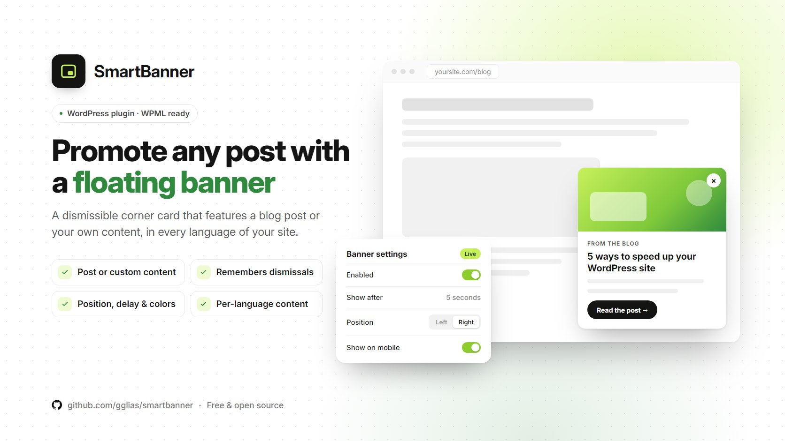

# SmartBanner

A floating banner for WordPress that sits in the bottom corner and promotes a blog post you choose, or your own custom content. Visitors can close it and it stays closed. WPML ready.

> [!NOTE]
> **Built for the Smartup website.** This plugin was made for Smartup's own website ([smartupweb.com](https://smartupweb.com)). Some settings may show the Smartup name by default, and in a few places it may not be changeable from the admin.
>
> **Need a white-label version?** Send me a message or email me at **[gglias.pro@gmail.com](mailto:gglias.pro@gmail.com)** and tell me what you need.

## Features

- **Post or custom content.** Pick a published blog post and the title, excerpt and featured image fill in automatically. Or write your own label, title, text, image and button.
- **Remembers dismissals.** A visitor who closes the banner won't see it again until the content changes. You choose how long it stays hidden (hours, or until the browser closes), and you can show it to everyone again with one click.
- **Placement and timing.** Left or right corner, X/Y offsets, a show delay (0–120 s), z-index, and the option to open links in a new tab.
- **Mobile control.** Show or hide it on mobile, and hide the image on small screens.
- **Your colors.** Set the button background and text colors.
- **WPML.** Separate content for each language, with English and Greek defaults. Greek translation included.
- **Plays nicely with editors.** It stays hidden inside Elementor, WPBakery and the Customizer, and on the post it is promoting. Admins can preview it with `?smartbanner_preview`.

## Requirements

- WordPress 6.1 or newer
- PHP 7.4 or newer

## Installation

1. Download the latest `smartbanner.zip` from [Releases](../../releases).
2. In WordPress go to **Plugins → Add New → Upload Plugin**, choose the zip and click **Install Now**.
3. Activate **SmartBanner** and open its settings page to set it up.

Or clone this repository into `wp-content/plugins/smartbanner`.

> [!IMPORTANT]
> The plugin doesn't update itself from WordPress.org. To update, download the new release and upload it again.

## License

[GPL-2.0-or-later](LICENSE).

Made by **GG** · [Greg Glias](https://gglias.github.io)
